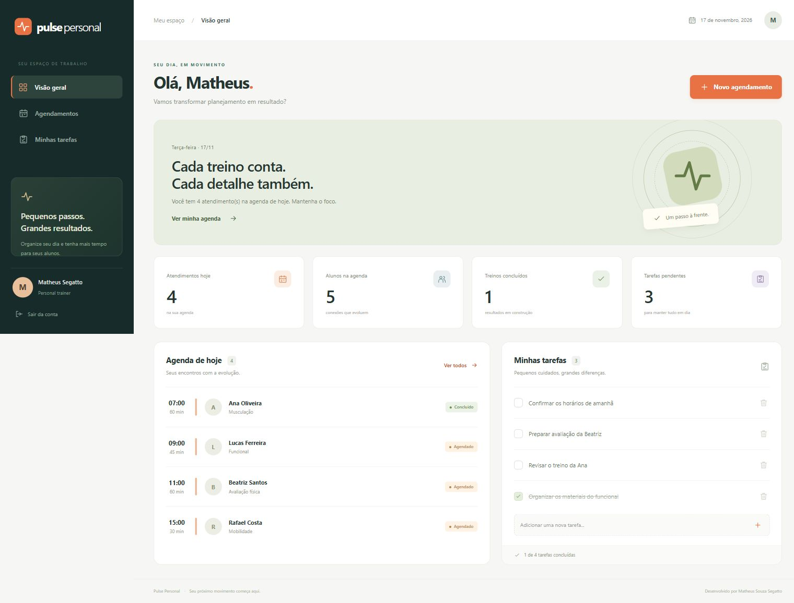

# Pulse Personal

Sistema de agendamentos para personal trainers desenvolvido para a **ACQA — PHP, MySQL, MVC e Design Patterns**.

**Aluno:** Matheus Souza Segatto  
**Tema:** organização de atendimentos e tarefas de um personal de academia.



## Funcionalidades

- Cadastro de usuário e login com senha protegida por **bcrypt**.
- Dashboard com atendimentos do dia, indicadores e lista de tarefas do usuário logado.
- Tarefas: adicionar, concluir, reabrir e excluir.
- CRUD completo de agendamentos: criar, listar, pesquisar, editar e excluir.
- Modalidade, aluno, data, horário, duração, situação e observações em cada atendimento.
- Filtros por aluno/modalidade e situação; proteção contra sobreposição de horários.
- Layout responsivo, com identidade visual própria, ícones SVG locais e sem dependências de CDN.
- Separação dos registros por usuário, consultas preparadas, escape HTML e proteção CSRF.

## Requisitos e instalação

PHP **8.2 ou superior**, extensões `pdo_mysql` e `mbstring`, MySQL **8.0.16 ou superior** e Git. Não é necessário Composer. Node.js 20+ é necessário somente para executar os testes automatizados.

1. Clone este repositório e entre na pasta do projeto.
2. Importe `database/schema.sql` no MySQL (por exemplo, na aba **Importar** do phpMyAdmin). O arquivo cria o banco `pulse_personal` e suas três tabelas.
3. Crie um usuário MySQL próprio para a aplicação, com permissões `SELECT`, `INSERT`, `UPDATE` e `DELETE` sobre `pulse_personal.*`.
4. Copie `.env.example` para `.env` e preencha host, porta, usuário e senha do banco. Não publique o arquivo `.env`.
5. Opcionalmente, carregue os dados fictícios de demonstração:

   ```sh
   php scripts/seed.php
   ```

6. Inicie o servidor na raiz do projeto:

   ```sh
   php -S 127.0.0.1:8080 -t public
   ```

7. Acesse **http://127.0.0.1:8080**. Cadastre uma conta ou use a demonstração.

**Conta de demonstração:** `demo@pulse.local` · **Senha:** `Pulse@2026`. São credenciais de dados fictícios criados exclusivamente pelo seed. O seed é opcional e não altera uma conta demo já existente. Os atendimentos são criados na data da execução; contas novas começam sem registros.

### Ambiente Windows preparado nesta máquina

Os executáveis locais estão na pasta ignorada `.runtime/`, com MySQL na porta **3307**, banco configurado em `.env` e dados fictícios carregados. Para iniciar novamente no PowerShell, execute `./scripts/start-local.ps1`. Se o PHP já estiver em execução, use outra porta: `./scripts/start-local.ps1 -Port 8081`.

Essa pasta, o banco de dados e as credenciais locais **não fazem parte do repositório**. Em outra máquina, siga a instalação acima com seu PHP e MySQL. Para Apache/XAMPP, configure o DocumentRoot como `public/`; não exponha a raiz inteira do projeto. As rotas usam query string e não dependem de mod_rewrite. O servidor embutido é para desenvolvimento local.

## Organização MVC

```text
app/
  Controllers/     AuthController, DashboardController, AppointmentController
  Core/            conexão PDO e controller base
  Models/          regras de validação de agendamentos
  Repositories/    persistência de usuários, agendamentos e tarefas
  Views/           templates, layouts e formulários
  bootstrap.php    autoload, configuração e helpers
public/
  index.php        Front Controller e tabela explícita de rotas
  assets/          CSS, JavaScript e ícones locais
database/          schema MySQL
scripts/           seed e inicialização local
tests/             testes HTTP com MySQL real
docs/              prints, arquitetura e conclusão da entrega
storage/           logs locais, ignorados no Git
```

- **Model:** `Appointment` concentra as regras dos dados; os repositories constituem a camada de persistência do modelo. Nenhuma view executa SQL.
- **View:** arquivos PHP em `app/Views` apresentam os dados e os formulários.
- **Controller:** recebe as ações, valida a entrada, chama os repositories e escolhe a view ou o redirecionamento.

Fluxo: **navegador → public/index.php → controller → model/repository → MySQL → view → navegador**.

## Design Patterns

1. **Singleton — `app/Core/Database.php`:** construtor privado e método estático `connection()` mantêm uma única conexão PDO por processo/requisição. Os repositories reutilizam essa conexão.
2. **Repository — `app/Repositories`:** encapsula consultas e gravações em classes específicas, mantendo SQL fora dos controllers e views. Todas as operações de agendamento recebem o identificador do usuário.
3. **Front Controller — `public/index.php`:** um ponto de entrada centraliza sessão, cabeçalhos, rotas, autenticação, CSRF e tratamento de erros.

Detalhes adicionais em [Arquitetura](docs/ARQUITETURA.md).

## Banco de dados

- `users`: nome, e-mail único e hash bcrypt.
- `appointments`: chave estrangeira do usuário, aluno, modalidade, horário, duração, situação e observações.
- `tasks`: chave estrangeira do usuário, título e indicador de conclusão.

As relações são **users 1:N appointments** e **users 1:N tasks**, com InnoDB, chaves estrangeiras, índices e charset `utf8mb4`. Os dados de um usuário não aparecem na conta de outro. Nomes de alunos pertencem aos agendamentos; não há cadastro independente de alunos.

## Verificação

Com o servidor PHP e MySQL ativos, execute na raiz:

```sh
node tests/smoke.mjs
```

O teste cria duas contas temporárias, verifica cadastro/login/logout, bcrypt, cookie, CSRF, XSS, CRUD, filtros, datas/durações, conflitos e isolamento entre usuários. Depois remove apenas as contas desta execução e seus registros relacionados. Os 37 cenários passaram no ambiente PHP 8.4 / MySQL 8.4 preparado para esta entrega. O teste também aceita `TEST_URL` e `PHP_BIN` como variáveis de ambiente. A extensão `pdo_mysql` precisa estar habilitada no PHP usado pelo teste.

O projeto foi verificado no navegador desktop. O CSS inclui adaptações para telas móveis; a ferramenta de navegador não aplicou a dimensão solicitada, portanto a conferência visual móvel permanece pendente. A conta demo e os prints contêm somente dados fictícios.

## Prints para a avaliação

1. [Tela de login](docs/prints/01-login.jpg)
2. [Tela de cadastro](docs/prints/02-cadastro.jpg)
3. [Dashboard e tarefas](docs/prints/03-dashboard.jpg)
4. [Adição de agendamento](docs/prints/04-novo-agendamento.jpg)
5. [CRUD: lista de agendamentos](docs/prints/05-agendamentos.jpg)
6. [Adição de tarefa](docs/prints/06-adicionar-tarefa.jpg)

A lista de tarefas do dashboard atende ao requisito da atividade e o CRUD tem como tema os agendamentos do personal. A inclusão de tarefa ocorre no próprio dashboard.

## Entrega

Consulte [RESPOSTA_DO_ALUNO.md](docs/RESPOSTA_DO_ALUNO.md) para o link do repositório e a conclusão. A versão em texto está em [RESPOSTA_DO_ALUNO.txt](RESPOSTA_DO_ALUNO.txt).

O desenvolvimento e a documentação do projeto contaram com auxílio de inteligência artificial.
