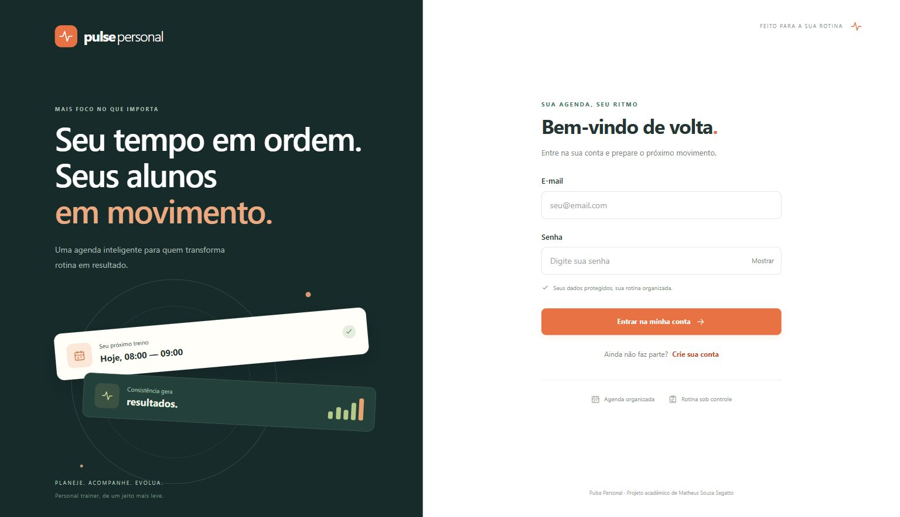
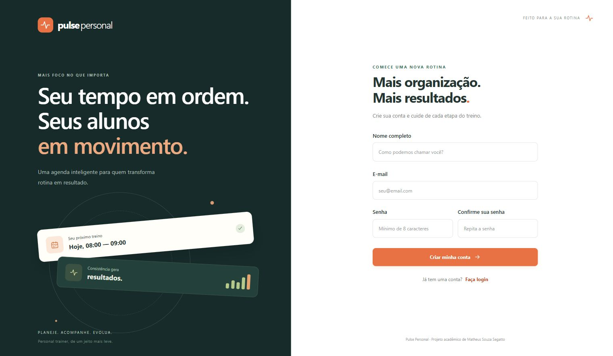
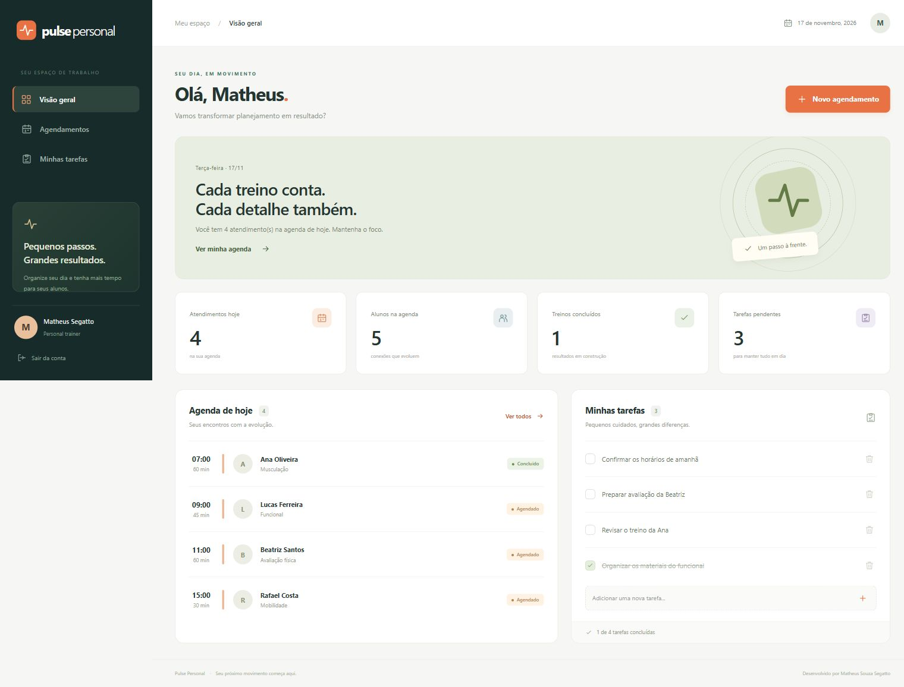
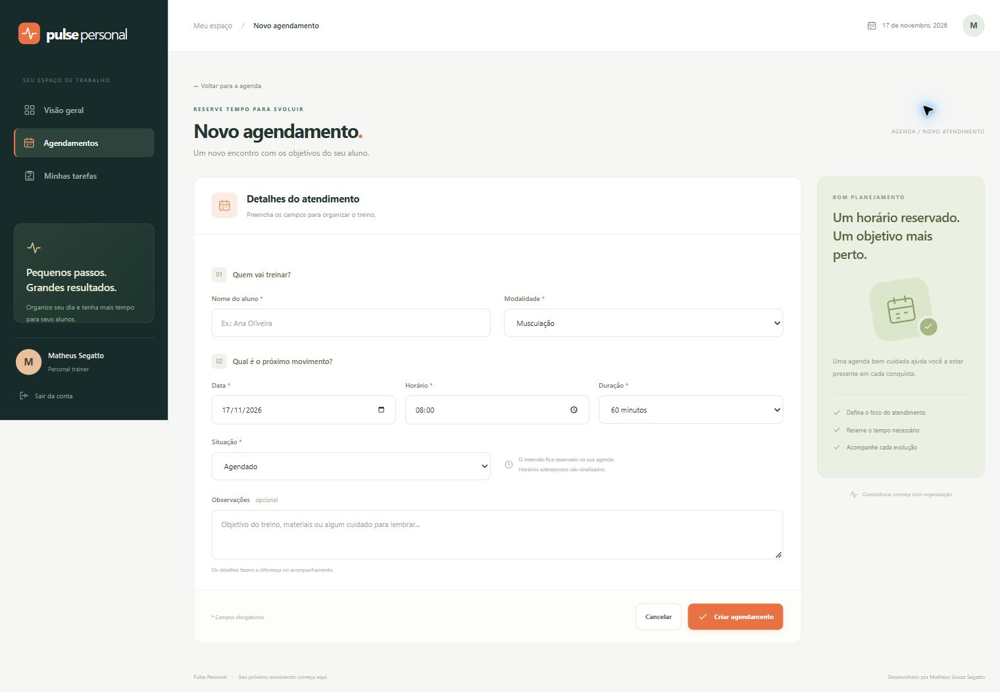
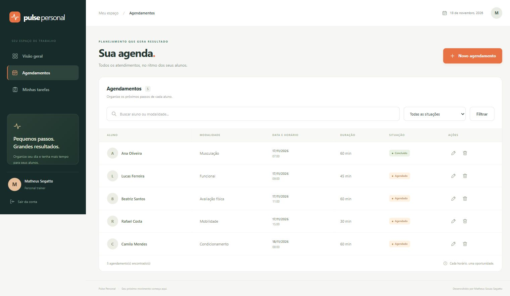
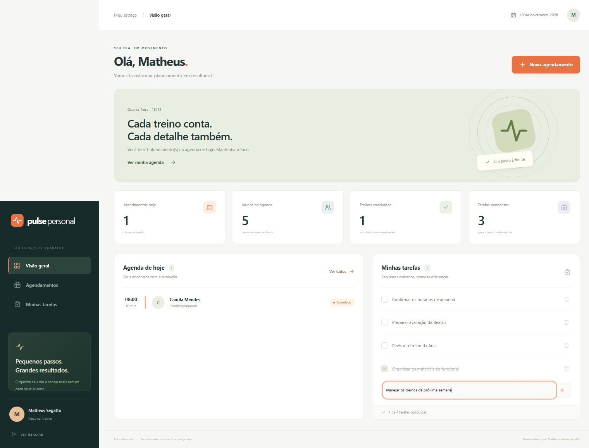

# Resposta do aluno

**Aluno:** Matheus Souza Segatto

**Repositório GitHub:** https://github.com/segattoz/pulse-personal-acqa

## Conclusão

O Pulse Personal é um sistema de agendamentos para personal trainers, desenvolvido em PHP e MySQL. Possui cadastro e login com senhas protegidas por bcrypt, dashboard com tarefas do usuário e CRUD completo de agendamentos, permitindo inserir, consultar, atualizar e excluir atendimentos.

A arquitetura MVC separa as regras e os dados, a apresentação das telas e o controle das requisições. Foram utilizados os padrões Singleton, para reutilizar a conexão PDO; Repository, para organizar o acesso ao banco; e Front Controller, para centralizar as rotas e verificações de segurança. O sistema também utiliza consultas preparadas, proteção CSRF, isolamento dos dados por usuário e validação de conflitos de horário.

.

## Telas do sistema

### 1. Login

Tela de acesso à conta do personal trainer.

### 2. Cadastro

Formulário para criação da conta do usuário.

### 3. Dashboard com tarefas

Página inicial com atendimentos do dia, indicadores e tarefas do usuário autenticado.

### 4. Adição de agendamento

Formulário do CRUD para cadastrar um atendimento, informando aluno, modalidade, data, horário e duração.

### 5. Listagem de agendamentos

Consulta dos atendimentos com busca, filtro por situação e opções para editar e excluir registros.

### 6. Adição de tarefa

Inclusão de uma tarefa na lista do dashboard.

